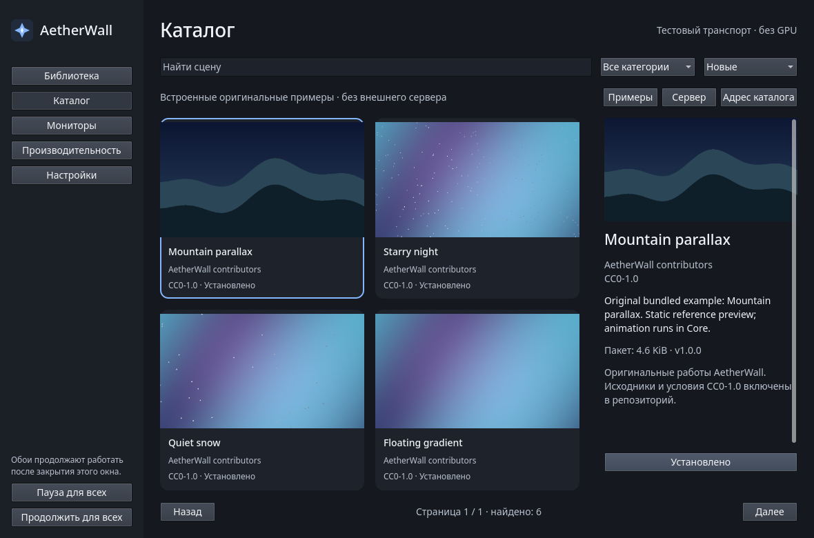

# AetherWall

**Живые обои для Windows 11: собственные GPU-сцены, несколько мониторов и управление нагрузкой.**

AetherWall рисует анимированные сцены на Direct3D 11 и HLSL и размещает их за
значками рабочего стола. Выбирайте обои в приложении, назначайте разные сцены
мониторам и задавайте, когда анимацию нужно приостановить. После закрытия окна
управления обои продолжают работать — движок остаётся в системном трее.

[Скачать для Windows](https://github.com/Ordo-xsenos/open_wallpaper/releases) ·
[Сборки CI](https://github.com/Ordo-xsenos/open_wallpaper/actions/workflows/release-preview.yml) ·
[Сообщить о проблеме](https://github.com/Ordo-xsenos/open_wallpaper/issues)

*Настоящий скриншот интерфейса из Linux-среды разработки. Тестовое подключение
обозначено в окне; это не демонстрация рендеринга рабочего стола Windows.*

## Что умеет

- **Сцены на GPU.** Слои изображений, градиенты, движение и частицы: звёзды,
  дождь и снег. Шесть оригинальных примеров включены в приложение.
- **Несколько мониторов.** Одна сцена на всех экранах или отдельная для каждого,
  с учётом расположения и DPI.
- **Контроль анимации.** Лимит 15/30/60 FPS, выбор GPU и правила паузы при
  полноэкранном приложении, работе от батареи и блокировке компьютера.
- **Локальная библиотека.** Импорт папок сцен и пакетов `.awscene`, поиск,
  избранное и сохранение назначений между запусками.
- **Каталог.** Поиск, категории и загрузка с отменой и проверкой SHA-256.
  Встроенные примеры доступны без сервера; установленная библиотека работает офлайн.
- **Русский и английский интерфейс.** Тёмное приложение на Qt, управление через
  трей и необязательный автозапуск при входе в Windows.

## Скачать и установить

Нужна **Windows 11 24H2 или новее (build 26100+), x64** и видеокарта с поддержкой
Direct3D 11. Для готовой сборки не нужны Visual Studio, Qt или Python.

Откройте [Releases](https://github.com/Ordo-xsenos/open_wallpaper/releases), выберите
нужную предварительную сборку и раскройте **Assets**:

| Файл | Для чего |
| --- | --- |
| `AetherWall-…-win-x64-setup.exe` | Установщик — обычный способ установки |
| `AetherWall-…-win-x64.zip` | Приложение без установки: распакуйте ZIP целиком |
| `SHA256SUMS.txt` и `*.sha256` | Контрольные суммы скачанных файлов |
| `AetherWall-M5.zip` | Исходники проекта, не готовое приложение |
| `qt…-source.zip` | Сопутствующие исходники Qt для распространения зависимостей |

Установщик работает без прав администратора и размещает приложение в
`%LOCALAPPDATA%\Programs\AetherWall`. Автозапуск включается отдельно в настройках.
В ZIP-версии запускайте `AetherWall.Manager.exe`; сохраняйте рядом все DLL и папки.
Обе версии хранят библиотеку и настройки в профиле пользователя.

## Первый запуск

1. Откройте **AetherWall** и нажмите **«Запустить движок»**.
2. Выберите сцену в **«Библиотеке»**, укажите монитор и примените её.
3. В настройках производительности выберите FPS и правила паузы.

Окно Manager можно закрыть: обои останутся активны. Для полного завершения
используйте соответствующую команду приложения или меню в трее. Перед обновлением
или удалением завершите движок полностью. Удаление приложения сохраняет библиотеку,
настройки и исходные импортированные файлы.

Для проверки рендеринга в обычном окне запустите `AetherWall.Manager.exe --core-window`
и затем включите движок. Этот режим помогает отделить ошибки GPU от интеграции
с рабочим столом.

## Свои сцены и каталог

В основе сцены — `manifest.json`, изображения и встроенные эффекты. Импортируйте
папку или `.awscene` через библиотеку; формат и ограничения описаны в
[руководстве по сценам](docs/SCENE_FORMAT.md). Исходники примеров находятся в
[scenes/](scenes/README.md).

Публичный сервер каталога по умолчанию не задан. На странице **«Каталог → Примеры»**
можно открыть встроенные сцены. Для собственного каталога укажите HTTPS-адрес в
настройках; [сервер FastAPI](server/README.md) поддерживает поиск, модерацию и
локальное либо S3-совместимое хранилище. Контент публикуется с подтверждёнными
правами автора.

## Статус проекта

AetherWall находится в стадии **preview**. Успешная CI-сборка проверяет компиляцию
и автоматические тесты; полная матрица Windows, разных GPU и конфигураций мониторов
ещё требует проверки. Интеграция с оболочкой Windows экспериментальная.
Показатели производительности пока не заявлены. Текущие сборки не подписаны.

После успешной сборки `main` CI автоматически создаёт отдельный **Pre-release**
в Releases с установщиком, ZIP, исходниками и контрольными суммами. Ошибочные
сборки и pull request не публикуются. Каждая публикация привязана к своему коммиту
и не заменяет файлы предыдущей.

При проблеме приложите версию сборки, Windows, GPU/драйвер, описание действий и
логи из `%LOCALAPPDATA%\AetherWall\logs`. Проверки и известные ограничения:
[матрица приёмки](docs/M5_TEST_PLAN.md), [совместимость рабочего стола](docs/DESKTOP_INTEGRATION.md).

## Разработка

C++20, Direct3D 11/HLSL, Qt Quick и SQLite. Движок Core отвечает за рендеринг,
состояние и трей; Manager общается с ним через Named Pipe и выполняет сетевые
запросы. Сервер каталога на Python запускается отдельно.

- [Сборка из исходников и диагностика](docs/DEVELOPMENT.md)
- [Сборка установщика и публикация](docs/RELEASE.md)
- [Формат сцен](docs/SCENE_FORMAT.md) и [протокол IPC](docs/IPC.md)
- [Статус реализации](docs/IMPLEMENTATION_STATUS.md) и [спецификация](WINDOWS11_WALLPAPER_ENGINE_SPEC.md)

## Лицензия

Код проекта — [MIT](LICENSE). Оригинальные сцены — CC0-1.0.
У зависимостей собственные условия: [сторонние компоненты и лицензии](THIRD_PARTY_NOTICES.md).
